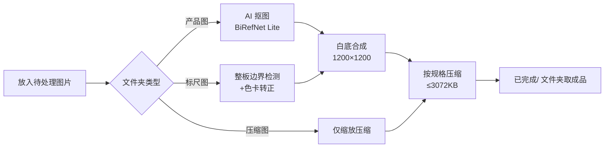

# 中药饮片图片批量处理工具 v8

面向中药材电商运营的本地图片批量处理工具：AI 抠图、白底合成、标尺板整板识别转正、按平台规格压缩输出。全部处理在本地完成，**不上传任何产品图片**。

为药店/药企平台的商品上架场景定制，内置两套平台规格：

| 平台 | 规格 |
|---|---|
| 药师帮 | 1200×1200，≤3MB |
| 1药城 | 800×800，≤2MB |

## 功能特性

- **🤖 本地 AI 抠图**：基于 [BiRefNet](https://github.com/ZhengPeng7/BiRefNet)（经 [rembg](https://github.com/danielgatis/rembg) 推理）的高精度主体分割，替代传统颜色阈值算法
- **📐 标尺图整板识别**：自动定位整块标尺板的四边边界，完整保留刻度、色卡和板上饮片，不依赖纯黑吸光布
- **🔄 自动转正**：根据彩色色卡识别朝向，横放、竖放、倒置、轻微倾斜都能自动转正为"公司名称在上方、色卡在左侧"
- **⬜ 白底等比合成**：主体居中、固定留白（pad），保留原始透视，不拉伸变形
- **📦 批量处理**：支持根目录图片与多层子目录同时处理，自动排除输出目录
- **🛡️ 明确报错设计**：体积无法达标、朝向无法识别时明确报错，绝不悄悄输出超限图片或猜测朝向的成品

## 处理流程



## 快速开始

### 日常使用（Windows）

1. 把图片放入对应的工作文件夹
2. 双击 `开始.bat`
3. 到该文件夹的 `已完成/` 里取成品

### 各文件夹功能

| 文件夹 | 功能 | 输出 |
|---|---|---|
| `药师帮_产品图` | AI 抠图 → 白底 → 等比居中 | 1200×1200，≤3072 KB |
| `药师帮_标尺图` | 整块标尺板抠图 → 白底 → 等比居中 | 1200×1200，≤3072 KB |
| `药师帮_主图压缩（1200x1200）` | 只缩放压缩，不抠图 | 1200×1200，≤3072 KB |
| `1药城_压缩（800x800像素）` | 只缩放压缩，不抠图 | 800×800，≤2000 KB |

### 换电脑部署

环境要求：Windows，Python 3.11 或 3.12

```powershell
cd 程序文件
python -m pip install -r requirements.txt
python 安装抠图模型.py
python process.py
```

首次安装模型需从 rembg 官方发布地址下载约 224 MB，模型默认安装到 `%USERPROFILE%\.u2net\birefnet-general-lite.onnx`（可用环境变量 `U2NET_HOME` 指定其他目录）。

## 目录结构

```
中药饮片图片批量处理工具/
├── 开始.bat                    # 一键启动入口
├── 使用说明.txt                # 精简版日常说明
├── 药师帮_产品图/              # 输入：产品图（AI 抠图）
├── 药师帮_标尺图/              # 输入：标尺图（整板识别）
├── 药师帮_主图压缩（1200x1200）/  # 输入：仅压缩
├── 1药城_压缩（800x800像素）/     # 输入：仅压缩
└── 程序文件/                   # 代码、配置、依赖（请勿删除）
    ├── process.py              # 主程序：批量调度、压缩、异常处理
    ├── product_cutout.py       # 产品图抠图（BiRefNet 分割 + 蒙版后处理）
    ├── board_cutout.py         # 标尺板整板检测、色卡转正
    ├── folders.ini             # 各文件夹的处理配置（JSON 格式）
    ├── requirements.txt        # Python 依赖
    ├── 安装抠图模型.py          # 模型下载脚本
    ├── test_product_cutout.py / test_board_cutout.py  # 单元测试
    └── verify_cutout_samples.py  # 实拍样图回归验证
```

## 配置说明

`程序文件/folders.ini` 使用 JSON 格式，产品图推荐配置：

```json
{
  "name": "药师帮_产品图",
  "method": "bag",
  "model": "birefnet-general-lite",
  "erode": 0,
  "feather": 0,
  "pad": 30,
  "size": 1200,
  "max_kb": 3072,
  "fill_holes": true,
  "refine_edges": true
}
```

| 参数 | 说明 |
|---|---|
| `method` | `bag`＝产品抠图；`board`＝标尺整板；省略＝仅缩放压缩 |
| `model` | 可选 `birefnet-general-lite` / `birefnet-general` / `u2net` / `isnet-general-use` |
| `pad` | 最终方图四周留白（像素），按输出尺寸计算 |
| `erode` / `feather` | 蒙版收缩 / 羽化。袋装建议保持 0，避免切掉封边 |
| `fill_holes` | 完整袋装、罐装设 `true`；带提手孔等真实孔洞的物品设 `false` |
| `size` / `max_kb` | 输出边长与体积上限 |
| `save_mask` | 设 `true` 额外保存蒙版 PNG，便于排查问题 |

## 抠图技术细节

- BiRefNet Lite 模型批量复用，每批不重复加载
- 检测到多个分离主体或主体过小时，自动扩大背景上下文重新推理（背景仅供模型判断，输出仍为原照片内容）
- 封闭包装内部填洞，避免深色药材、标签或反光处被挖空
- 仅沿轮廓做小范围引导滤波保边精修，不用凸包拉直袋子褶皱
- 根据透明蒙版裁切，保留浅色和细小边角；预乘透明度缩放，减少脏边
- 旧袋装算法保留为 `method: "bag_legacy"` 备用

## 标尺图整板模式

`method: "board"` 通过板面色差、四边几何和边界对比定位整块板子：

- 刻度、色卡、板面及板上饮片**全部保留**，板内黑色药材与白色反光区不会被挖空
- 只旋转、不拉伸板子，保留原始透视，并校正轻微歪斜
- 色卡缺失、遮挡或方向证据冲突时**明确报错**，不输出猜测朝向的成品
- 拍摄要求：整块板子拍全、四边清晰、彩色色卡完整入镜

## 隐私与安全

- 所有处理**均在本地完成**，模型推理不上传任何照片
- 缺少本地模型时直接报错退出，不会自动降级联网处理

## 测试与验证

```powershell
cd 程序文件

# 单元测试
python -m unittest -v test_product_cutout
python -m unittest -v test_board_cutout

# 全部回归测试
python -B -m unittest discover -p "test_*cutout.py" -v

# 实拍样图验证（输出前后对比图）
python verify_cutout_samples.py
```

已用 5 张袋装实拍图和 13 张标尺图实拍样图（含规范与不规范方向）完成回归验证。

## 已知边界

- 单张单产品是默认场景；多件商品并列不适合"保留主连通主体"的处理逻辑
- 原图已拍出画面外的袋角无法恢复
- 透明塑料边缘与背景完全同色时仍可能漏边；透明区域的背景染色无法靠轮廓处理完全消除
- 平台规格（药师帮 1200×1200/≤3MB、1药城 800×800/≤2MB）来自内部使用说明，未额外核实平台实时规则

## 致谢

- 分割模型：[BiRefNet](https://github.com/ZhengPeng7/BiRefNet)
- 推理接口：[rembg](https://github.com/danielgatis/rembg)

---

*原始图片不会被修改；同名输出会覆盖，请先保存需要保留的成品。*
